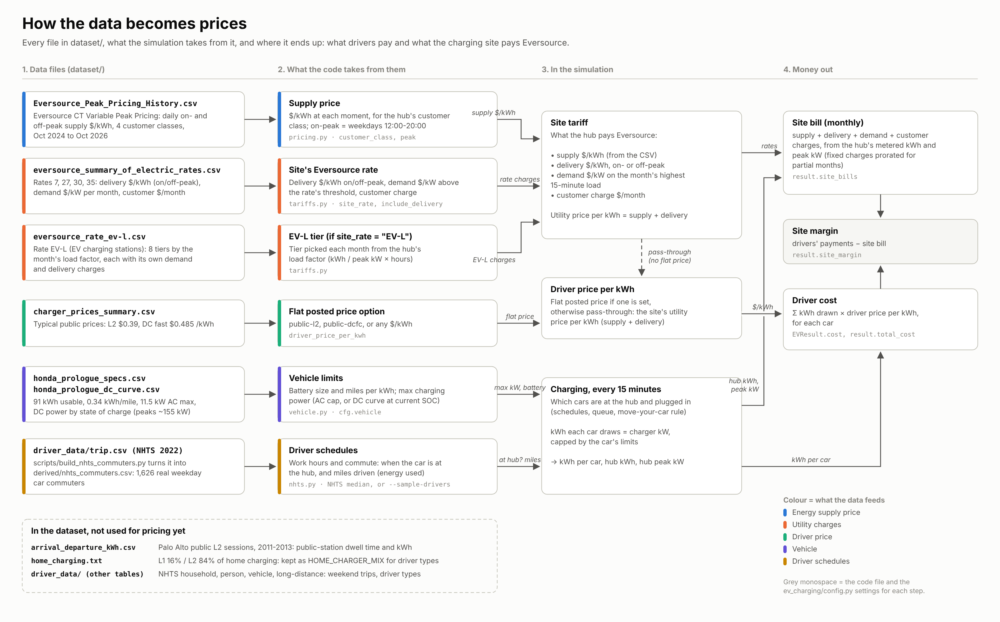

# EC601-EV-Charging-Project
This repository documents work done on an EV charging optimization project.

## Running the simulation

```
pip install -r requirements.txt
python run_single_ev.py                  # 1 EV, 0% -> 100%, prints the cost
python run_single_ev.py --plot --animate # also saves outputs/single_ev_dashboard.png and single_ev_hub.gif
python run_fleet_demo.py --evs 6 --chargers 2 --plot --animate   # cars queueing for chargers
python run_fleet_demo.py --show          # open the charts in a window instead of saving
python run_commute.py --plot --animate --every 2   # commuting drivers charging at a work hub
python run_commute.py --sample-drivers --region new-england   # real NHTS commuter schedules
python run_commute.py --driver-price public-l2     # drivers pay the public L2 price
python run_commute.py --charger-type DC --charger-kw 150 --site-rate EV-L --driver-price public-dcfc
python run_greedy.py                    # home + work + public: greedy vs always-charge, 10 drivers, 1 week
python run_greedy.py --start 2026-01-05 --plot   # winter (work fee cheaper than home off-peak) + dashboards
python run_greedy.py --animate --anim-days 3     # animated GIF per strategy: home, road, work, public
python run_greedy.py --sample-drivers --evs 10 --chargers 3 --home-types L2,L2,L1,none
python run_greedy.py --sample-drivers --seed 3 --evs 12 --chargers 1 --no-home-share 0.3 --days 14 --plot
                                        # crowded work hub + more renters: drivers use public stations
python scripts/build_nhts_commuters.py   # rebuild dataset/derived/nhts_commuters.csv from NHTS
python -m pytest
```

Assumptions (vehicle, charger power, peak hours, customer class, Eversource rate, driver
price, dates, and the driver's work hours and commute) live in `ev_charging/config.py`.
Data-backed pieces: `vehicle.py` (Honda Prologue specs and DC curve), `pricing.py`
(Eversource CT supply prices), `tariffs.py` (delivery, demand and customer charges, Rate EV-L,
public charging prices), `nhts.py` (driver schedules). The driver schedule logic is in
`ev_charging/driver.py`. Each run reports what drivers paid and the hub's monthly utility
bill (`result.site_bills`).



`resources/pricing_data_flow.svg` (drawn by `scripts/make_pricing_diagram.py`) shows how each
data file feeds the prices drivers pay and the site's utility bill. Charts and animations are in `ev_charging/viz/` and read the
per-step timeline that `Simulation` / `CommuteSimulation` record (`result.timeline`).

The module UML is `resources/decentralized_ev_charging_module_UML.drawio` (open in draw.io;
PNG preview next to it). It is generated by `scripts/make_uml_diagram.py`, so either edit that
script and re-run it, or edit the .drawio by hand and stop using the script.
